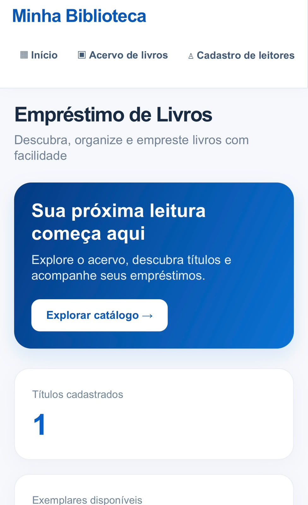
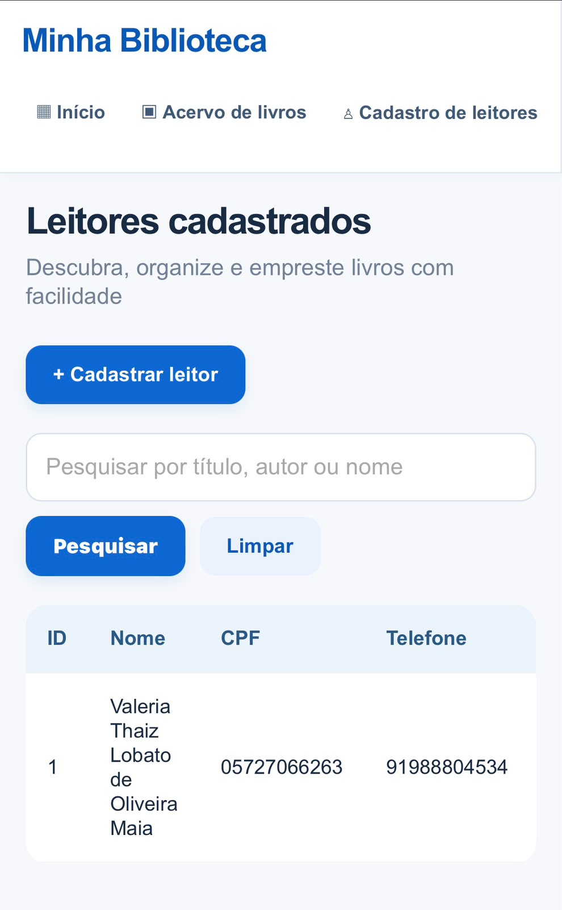
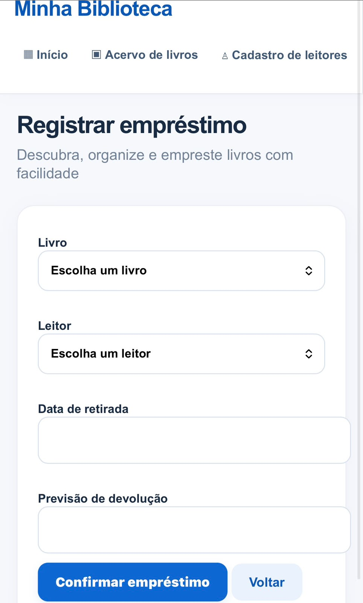
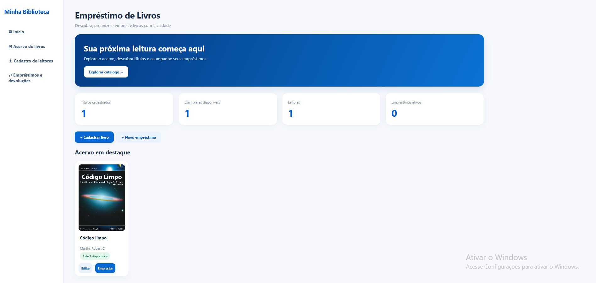
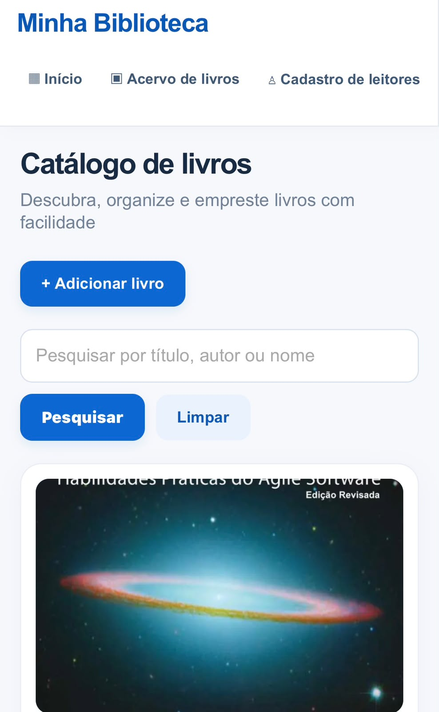
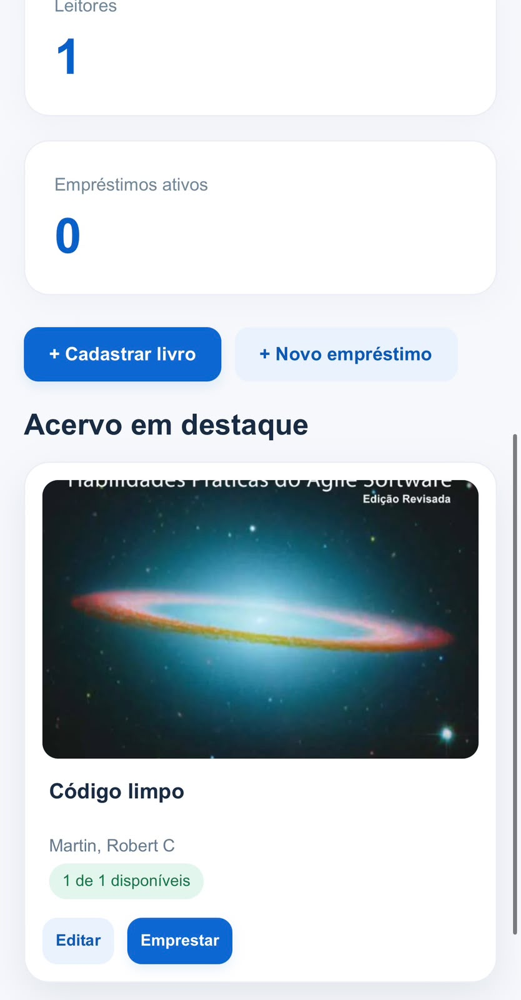

<div align="center">

# 📚 Sistema de Empréstimo de Livros

**Gerenciamento de biblioteca desenvolvido em C, com interface web para desktop e celular.**


</div>

---

## Sobre o projeto

O **Sistema de Empréstimo de Livros** é uma aplicação para organizar o acervo de uma biblioteca, cadastrar leitores e controlar a circulação de exemplares. A lógica de negócio, a persistência e o servidor HTTP foram implementados em **linguagem C**. A interface é entregue ao navegador por meio de HTML e CSS gerados pelo programa.

O catálogo utiliza uma proposta visual inspirada na navegação de plataformas digitais de livros, sem vínculo com a plataforma MEC Livros ou utilização de seu código.

## Funcionalidades

- **Painel inicial:** visão geral do acervo e das operações.
- **Catálogo:** consulta e pesquisa de livros com capas.
- **Livros:** cadastro, edição e exclusão de registros.
- **Capas:** envio de arquivos JPG, PNG ou BMP de até 5 MB pelo navegador.
- **Leitores:** cadastro, edição e exclusão de usuários.
- **Empréstimos:** registro e acompanhamento de livros emprestados.
- **Devoluções:** atualização da disponibilidade dos exemplares.
- **Persistência local:** armazenamento de registros em arquivos na pasta `dados/`.
- **Acesso em rede local:** uso no Chrome do notebook e de um celular conectado à mesma rede.

## Demonstração visual — capturas reais

As imagens abaixo foram registradas no **Chrome do notebook e do celular**. Os dados pessoais de leitores foram ocultados antes da publicação.

### 01 · Painel inicial

**Computador** — visão geral do acervo, disponibilidade e atalhos.



**Celular** — banner, indicadores e catálogo em destaque.

<p align="center"> </p>

### 02 · Catálogo de livros

Pesquisa por títulos e visualização de capas no celular.

<p align="center"></p>

### 03 · Cadastro de leitores

Listagem e pesquisa de leitores. **Informações pessoais foram ocultadas na imagem publicada.**

<p align="center"></p>

### 04 · Empréstimos e devoluções

Acompanhamento dos empréstimos e formulário para registrar retirada e previsão de devolução.

<p align="center"> </p>

> **Próximas capturas:** cadastro de livros com upload de capa, devolução registrada e versões desktop das demais telas. Essas imagens ainda não foram fornecidas.

## Tecnologias

| Componente | Tecnologia |
|---|---|
| Linguagem principal | C |
| Compilação no Windows | GCC (MSYS2 UCRT64 / MinGW-w64) |
| Compilação no Linux | GCC |
| Servidor | HTTP implementado em C, com sockets |
| Interface | HTML e CSS enviados pelo servidor em C |
| Armazenamento | Arquivos locais `.dat` |
| Ambiente de desenvolvimento | Visual Studio Code |

> **Nota técnica:** embora o servidor e as regras do sistema sejam escritos em C, a interface exibida no Chrome utiliza HTML e CSS, interpretados pelo navegador.

## Estrutura do projeto

```text
Biblioteca_C_Portugues_Comentado/
├── .vscode/
│   └── tasks.json
├── capas/
│   └── .gitkeep
├── dados/
│   └── .gitkeep
├── include/
│   └── biblioteca.h
├── src/
│   ├── biblioteca.c
│   └── main.c
├── testes/
│   ├── ROTEIRO_TESTES.txt
│   ├── testar_linux.sh
│   └── teste_regras.c
├── .gitignore
├── compilar.bat
├── compilar_linux.sh
├── LEIA_PRIMEIRO_COMENTARIOS.txt
├── README.md
└── README.txt
```

## Como executar no Windows

**Pré-requisitos:** Windows 10/11, GCC do MSYS2 UCRT64 configurado e Visual Studio Code (opcional).

1. Clone o repositório ou baixe o projeto em ZIP.
2. Abra a pasta que contém `compilar.bat` no VS Code.
3. No terminal PowerShell, compile:

   ```powershell
   .\compilar.bat
   ```

4. Inicie o servidor:

   ```powershell
   .\Biblioteca.exe
   ```

5. Abra o **Google Chrome** no notebook e acesse **`http://127.0.0.1:8765`**.

**Mantenha o terminal com `Biblioteca.exe` aberto** durante a utilização. Para encerrar o servidor, pressione `Ctrl + C`.

## Como acessar pelo celular

1. Conecte o celular e o notebook à **mesma rede Wi-Fi**.
2. Inicie `Biblioteca.exe` no notebook.
3. Descubra o IPv4 local do notebook com `ipconfig` no PowerShell.
4. No Chrome do celular, acesse `http://IP-DO-NOTEBOOK:8765`, substituindo pelo IPv4 encontrado.
5. Caso necessário, permita o executável no Firewall do Windows **somente em redes privadas**.

O endereço `localhost` funciona apenas no próprio dispositivo. O acesso pelo celular depende do notebook ligado, do servidor aberto e das permissões da rede local.

## Como executar no Linux

```bash
sh compilar_linux.sh
./Biblioteca
```

## Testes

Consulte [`testes/ROTEIRO_TESTES.txt`](testes/ROTEIRO_TESTES.txt) para o roteiro de validação manual e [`testes/teste_regras.c`](testes/teste_regras.c) para os testes do núcleo. Os resultados devem ser documentados após a execução no ambiente utilizado.

## Armazenamento e segurança

- Os registros são salvos localmente em `dados/*.dat`.
- As imagens enviadas pelo navegador são armazenadas em `capas/`.
- Arquivos de dados, capas enviadas por usuários e executáveis gerados **não devem ser versionados**; mantenha essas regras no `.gitignore`.
- **Não exponha o servidor à internet pública:** esta versão não possui autenticação nem HTTPS.
- Antes de atualizar o programa ou substituir arquivos, faça backup das pastas de dados e capas.

## Melhorias futuras

- Autenticação e perfis de acesso.
- Relatórios exportáveis de empréstimos e devoluções.
- Melhorias na concorrência e no tratamento de conexões HTTP.
- Testes automatizados adicionais e integração contínua.

## Autoria

**Valeria Maia** — desenvolvimento e organização do repositório acadêmico.

---

<div align="center">

**Projeto acadêmico • Sistema de Empréstimo de Livros • Linguagem C**

</div>
